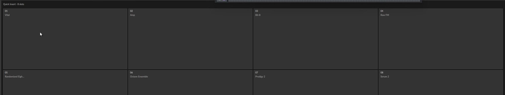
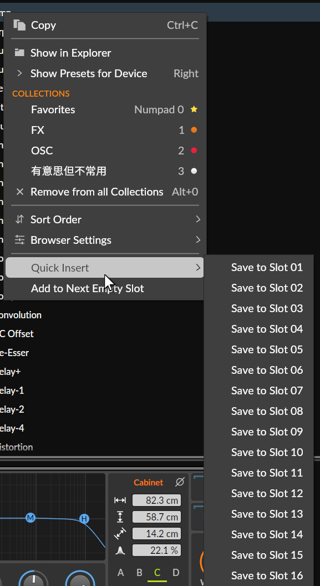

# Device: Quick Insert Slots

[](https://github.com/PureWOODs/quick-insert-slots/releases/latest)
[](https://github.com/PureWOODs/quick-insert-slots/blob/main/LICENSE)


A Shortcut Buddy for Bitwig, built on the BML mod kit: a grid of slots, each holding something you
can insert into a track — a Bitwig device, a preset, a whole chain, or a plug-in. Insert it with a
click in the panel, a right-click in the device menu, a key you bind, or the Commander.

The point of it is speed on the keyboard: give your few most-used plug-ins, presets and chains a slot
each, bind each slot to a key in **Settings → Shortcuts**, and one key press puts that thing into the
track you are on — no browser, no mouse, no hunting through the device panel.

There is no Bitwig device to put on a track and nothing to route: the slots live in the mod, and the
panel is where you see them all.

> **This mod needs [Patchbay](https://github.com/shaboogen-dev/Patchbay)** — an open-source (MIT)
> third-party mod loader for Bitwig, not made by Bitwig. A mod is a folder that Patchbay loads into
> Bitwig when it starts; Bitwig's own installation is never modified. Without Patchbay this zip does
> nothing.

## 快速开始 / Quick start

1. Install [Patchbay](https://github.com/shaboogen-dev/Patchbay) 0.36 or newer, import this zip, start Bitwig.
2. Right-click a plug-in, a device or a preset in Bitwig's browser → **Add to Next Empty Slot**
   (or **Quick Insert ▸ Save to Slot NN**).
3. **Settings → Shortcuts**, search "Quick Insert", and give `Slot 01` a key — `Ctrl+Alt+1` is a good one.
4. Press that key on any track: the thing lands in the track's chain — instruments at the top, effects
   at the end. No browser, no device panel, no mouse.

## 截图 / Screenshots

The panel — eight slots filled, each showing what it holds:



Saving from Bitwig's browser — right-click anything, then **Quick Insert ▸ Save to Slot NN** or
**Add to Next Empty Slot**:



## 中文说明

给 Bitwig 加一组「插入槽」：面板上有若干格子，每个格子记住一样东西 —— Bitwig 自带设备、预设
（`.bwpreset`）、整条效果链、VST3 或 CLAP 插件。

**主要用法是绑快捷键。** 把你最常用的那几样东西存进槽位，每个槽位绑一个键（比如
`Ctrl+Alt+1` = Pro-Q 4、`Ctrl+Alt+2` = Serum、`Ctrl+Alt+3` = 你常用的压缩链），之后在任何轨道上
按键，它就直接插进当前轨道——不用开浏览器、不用找设备面板、不用鼠标。常用插件从「翻找」变成
「一键」。

### 安装

1. 先装 [Patchbay](https://github.com/shaboogen-dev/Patchbay) **0.36.0-dev.13** 或更新版本（开源，
   MIT；它只在启动时把 mod 载入内存，不改 Bitwig 本体）。
2. 下载 [quick-insert-slots-0.1.3.zip](https://github.com/PureWOODs/quick-insert-slots/raw/main/dist/quick-insert-slots-0.1.3.zip)
   （27 KB）。
3. 把 zip 拖进 Patchbay 窗口，或用它的导入按钮；导入后它会出现在 mods 列表里。
4. 从 Patchbay 启动 Bitwig（或之后自行启动）。想在 Patchbay Launcher 里收到更新，就在
   **Sources → Mods → + Add** 里加上 `PureWOODs/quick-insert-slots`。

### 存槽

在 Bitwig 浏览器里右键任何设备、预设或插件：

- `Add to Next Empty Slot` —— 存进第一个空槽；
- `Quick Insert ▸ Save to Slot NN` —— 自己指定槽位。

存的是浏览器项目背后的文件，所以浏览器关掉、条目被筛掉之后槽位照样能用。内置设备其实也是文件
（`…\Library\devices\*.bwdevice`），一样可以存。VST3 如果是 bundle 文件夹，存的是里面真正的模块
文件（`Contents\<arch>\<name>.vst3`），因为 Bitwig 打不开文件夹。

### 快捷键：主要用法

1. 先在浏览器里右键常用的插件/预设 → `Add to Next Empty Slot`（或 `Save to Slot NN`），把它们存好。
2. 打开 `Settings → Shortcuts`，搜 “Quick Insert”，把 `Slot 01` 绑成 `Ctrl+Alt+1`、`Slot 02` 绑成
   `Ctrl+Alt+2`，以此类推。
3. 之后在任何轨道、任何窗口焦点下按下这个键，插件就插进当前轨道（没有选中设备时插入第一条选中轨道
   的链；右键设备时插到那条链）。乐器落在链首，效果器落在链尾。

这样最常用的插件就是「一键到位」：换轨道、换工程、关了浏览器都不影响，键位在所有工程里通用。

菜单和快捷键列表里只显示编号（`Slot 01` 而不是 `Pro-Q 4`），因为 Bitwig 在启动时只读一次动作名；
面板格子始终实时显示槽里是什么，存完不用重启就更新。

### 另外三种用法

- **面板**：点格子。面板会撑满给它的空间，格子大小随面板大小和槽位数量变化。
- **设备右键菜单**：`Quick Insert ▸ Slot NN`，走 Bitwig 自己的拖放 —— 乐器落在链首，效果器落在链尾。
- **Commander**：搜 `Slot NN`。

### 设置

`Settings → Mods → Quick Insert` 里有四项：

| 设置 | 作用 |
|---|---|
| Slots on show | 面板显示多少格：4、8、16、32、48、64。改完立即生效，不用重启；减少只是隐藏，槽位内容与快捷键都还在。 |
| Insert into all selected tracks | 打开后，面板/快捷键的插入会填满所有选中轨道（每条轨道单独一次插入，撤销也逐个来）。右键设备仍只作用于那条设备的链。 |
| Show a notice when a slot is used | 插入成功或失败时弹一条提示。 |
| Right-click clears a slot | 允许右键格子清空。 |

### 清空

右键面板格子，或在浏览器菜单里选 `Clear Slot NN`（只有非空槽位才出现），立即生效。

### 槽位存在哪里

`%LOCALAPPDATA%\BML\mods\quick-insert-slots\settings.properties`，每个槽位两个键：

```properties
slot.4.path=C:/Program Files/Common Files/VST3/FabFilter/FabFilter Pro-Q 4.vst3
slot.4.path.alt=…           浏览器给的是外层 bundle 时才有
slot.4.name=Pro-Q 4         面板显示的名字
slots.count=8               显示多少格
insert.all.selected=false   插入所有选中轨道
notify.enabled=true         使用槽位时提示
clear.right.click=true      右键清空
```

改的时候先关掉 Bitwig，或者平时用浏览器存槽、设置页改其余项。

### 失败时

- 槽位没反应：背后的文件被移动或卸载了，提示会说 *is missing*，重新存一次即可。
- 出现 `LoadLibrary … Error code: 5` 或元数据错误：槽位指向了一个 `.vst3` 文件夹。这个版本读取时会
  自动修成 `Contents\<arch>\<name>.vst3`；如果还报错，说明槽位指向的是别的东西。
- 菜单里没有 `Slot NN`、快捷键列表里也搜不到：某个 framework 缺失或太旧，或 mod 没载入。BML 目录下
  `sessions\<时间>\bml.log` 会写原因。

### 限制

- 一次插入一条轨道（除非打开「插入所有选中轨道」）。
- 槽位不能拖动排序，换内容就是重新存一次。
- 面板是撑满而不是滚动：短面板里放 64 格会很小，少放几格或把面板拉高。

## Requirements

- Bitwig Studio **6.1.4**, Windows x64 — that is what this build was made and tested against.
  Patchbay's maps may carry it to other 6.1.x builds; macOS and Linux are untested.
- [Patchbay / BML](https://github.com/shaboogen-dev/Patchbay) **0.36.0-dev.13** or newer — the mod
  loader (open source, MIT).
- These frameworks, installed as mods next to this one:
  - `action-menu-composition-framework` **0.7.0-dev.3** or newer
  - `panel-management-framework` **0.1.0-dev.3** or newer
  - `preferences-composition-framework` **1.0.0** or newer
  - `notifications-framework` **0.3.0-dev.1** or newer
  - (Panel management needs the Settings framework too, so both have to be present. The
    notifications framework is what shows "inserted" and "could not insert".)

## Download and install

**Download [`quick-insert-slots-0.1.3.zip`](https://github.com/PureWOODs/quick-insert-slots/raw/main/dist/quick-insert-slots-0.1.3.zip)**
(direct download, 27 KB). It is also attached to the
[latest release](https://github.com/PureWOODs/quick-insert-slots/releases/latest) under *Assets*.

1. Install [Patchbay / BML](https://github.com/shaboogen-dev/Patchbay) 0.36 or newer, and start it
   once so its mods folder exists.
2. **Import the zip in Patchbay**: drag it onto the Patchbay window, or use its import button. It
   checks the package, copies it into `mods\quick-insert-slots`, and lists it among the mods.
3. **Load Bitwig** from Patchbay, or start Bitwig again: the mod is there from the next run on.

To get updates from inside Patchbay Launcher, add this repository as a source once: **Sources →
Mods → + Add → `PureWOODs/quick-insert-slots` → Check**. The mod then appears under *Mods* with its
available version, and *Update* when a newer release is published.

The four frameworks under *Requirements* ship with Patchbay. If one is missing or older than listed,
Patchbay refuses to load this mod and says which.

Then open Settings → **Mods** → **Quick Insert**, which holds four options: how many slots are on
show (4, 8, 16, 32, 48 or 64), whether a click fills every selected track, whether using a slot says
so, and whether a right-click clears one.

The panel itself is offered as **Quick Insert** by whichever panel layout mod you use (Framework:
Panels, or Panel: Streamlined Views with its view switcher).

<details>
<summary>Installing without Patchbay</summary>

Unzip the release zip so that `mods\quick-insert-slots\mod.json` exists next to the frameworks, then
start Bitwig. That is what Patchbay does for you, minus the version checks.
</details>

## Filling a slot

Right-click anything in Bitwig's browser — a device, a preset, a plug-in, a sample — and pick
**Add to Next Empty Slot**, or **Quick Insert ▸ Save to Slot NN** to choose the slot yourself. What gets stored is the file
behind the browser item, so the slot keeps working when the browser is closed or the item is filtered
away.

Two things worth knowing:

- **Built-in Bitwig devices are files too** (`…\Library\devices\*.bwdevice`), so they can sit in a
  slot like anything else.
- **A VST3 that is a bundle folder is stored by its module**, not by the folder: Bitwig cannot load
  a folder, and asking it to gives *could not read metadata … LoadLibrary … Error code: 5*. This mod
  picks `Contents\<arch>\<name>.vst3` on its own.

## Using a slot

| Where | What it does |
|---|---|
| The **Quick Insert** panel | Click a cell. The panel fills the space it is given, so cells grow and shrink with its size and with the number of slots. |
| Right-click a **device** | `Quick Insert ▸ Slot NN` — inserts through Bitwig's own drop: an instrument at the top of the chain, an effect at the end. |
| **Settings → Shortcuts** | Bind any `Slot NN` to a key. A slot is named by its number alone — Bitwig reads an action name once, at launch, so a name in a menu would be the one the slot had at the start. The panel shows what is in each slot, live. Without a device in context the slot goes into the selected tracks (see below). |
| The **Commander** | Search `Slot NN`. |

How many slots a menu shows follows the setting, live: it is asked for each time Bitwig opens a menu,
so changing it needs no restart. Every slot keeps its settings and its key whatever number is on
show, so fewer slots now means the rest come back unchanged.

### Where a slot goes

Everything goes through Bitwig's own drop: an instrument lands at the top of the chain, an effect at
the end of it, and a chain or preset is merged the way dropping it on the device panel merges it.
Placing an effect yourself, right after the device the track has selected, was built and then
dropped again: Bitwig's own choice kept beating it, and an index taken from a selected device could
put an instrument among the effects.

**Which track it goes into.** A click in the panel, a key, or the Commander without a device in
context fills the first selected track with a device chain. Turn on **Settings → Mods → Quick
Insert → Insert into all selected tracks** and it fills every selected track instead — one click for
a whole selection of tracks. Each track is its own insertion, so Bitwig's undo takes them back one
at a time. Right-clicking a device always means that device's own chain, whatever the setting says.

**What the notice says.** Nothing is reported until Bitwig has actually taken the drop: the
insertion reports its own outcome, so a plug-in that fails to load (a licence prompt, a missing
dependency) says *could not insert …* instead of a "inserted" that never happened. The report is
the insertion's own listener — `lBQ`, not the bare `oRV` the method's signature suggests: Bitwig
casts the listener it is given to `lBQ` inside, and a plain `oRV` throws there and nothing is
inserted. Turn the notices off under **Settings → Mods → Quick Insert → Show a notice when a slot
is used**; the mod log keeps every line either way.

### Clearing a slot

A slot is emptied where it is: a **right-click on its cell** in the panel, or **Clear Slot NN** in the
browser's Quick Insert menu (that entry only appears for a slot with something in it). Both take
effect at once, without a restart. Right-click clearing can be turned off under **Settings → Mods →
Quick Insert → Right-click clears a slot** for anyone who would rather not have it a click away. Lowering **Slots on show** hides the extra slots instead of emptying
them: their settings, their keys and their content stay, and they come back unchanged.

### Sharing a key with another action

Bitwig refuses to bind a key that another action already uses. [Shortcuts: Share a
Key](https://github.com/shaboogen-dev/Mods) adds an **Add** button to the shortcut dialog for that:
it puts the key on one more action, and Bitwig then runs all of them, starting at whatever has the
focus. This mod needs nothing for that — its actions are ordinary actions, so Share a Key puts a slot
on a key you already use.

## Where the slots are stored

`%LOCALAPPDATA%\BML\mods\quick-insert-slots\settings.properties`, two keys per slot plus the
settings:

```properties
slot.4.path=C:/Program Files/Common Files/VST3/FabFilter/FabFilter Pro-Q 4.vst3
slot.4.path.alt=…             only when the browser named a bundle around the module
slot.4.name=Pro-Q 4           what the panel calls it
slots.count=8                 how many slots are on show
insert.all.selected=false     fill every selected track
notify.enabled=true           say so when a slot is used
clear.right.click=true        a right-click on a cell empties it
```

Edit it with Bitwig closed, or set slots from the browser and the rest from Settings.

## When something does not work

- **Nothing in the menus, no `Slot NN` in Shortcuts** — one of the frameworks is missing or too old,
  or the mod did not load. The loader's log says why: `sessions\<time>\bml.log` in the BML folder.
- **An error box about metadata or `LoadLibrary … Error code: 5`** — a slot points at a `.vst3`
  folder. This version repairs that on read; if you still see it, the slot points at something else
  that Bitwig cannot open.
- **A slot does nothing** — the file behind it moved or was uninstalled. A toast names the slot
  and says *is missing*; re-save it from the browser. When Bitwig refuses what the slot holds, the
  toast says so too, and the panel keeps showing the file name.

## Limits

- One target track: the first selected track (or the chain of the device the menu was opened on).
- No drag and drop reordering of slots; re-save into a slot to change it.
- The panel fills its space rather than scrolling: with 64 slots in a short panel the cells get
  small. Use fewer slots on show, or give the panel more height.

## 搜索关键词 / Keywords

Bitwig, Bitwig Studio, quick insert, quick-insert-slots, device slot, preset slot, chain slot,
hotkey, keyboard shortcut, Patchbay, BML mod, VST3, CLAP, 快速插入, 插入槽, 预设, 快捷键, 音色,
设备链.

## 致谢 / Credits

- **DeepSeek** —— 这个 mod 的代码、构建与打包脚本、发布流程和文档，都是在 DeepSeek 的编码 agent
  （DeepSeek Harness）协助下完成的：BML 混淆 API 的勘察、面板绘制、插入与存储逻辑、编译、离线
  `prepare-mod` 验证、zip 打包，以及这份 README。
- **[shaboogen-dev](https://github.com/shaboogen-dev)** —— [Patchbay / BML](https://github.com/shaboogen-dev/Patchbay)
  提供了这套 mod 框架（MIT），[Mods](https://github.com/shaboogen-dev/Mods) 里的现成 mod 是写这个 mod 时的参考。

*English: the code, build and packaging scripts, the release process and this README were written with
DeepSeek (the DeepSeek Harness coding agent) — from mapping Bitwig's obfuscated API, through the panel
and insertion logic, to compiling, offline `prepare-mod` checks and packaging the zip.*
